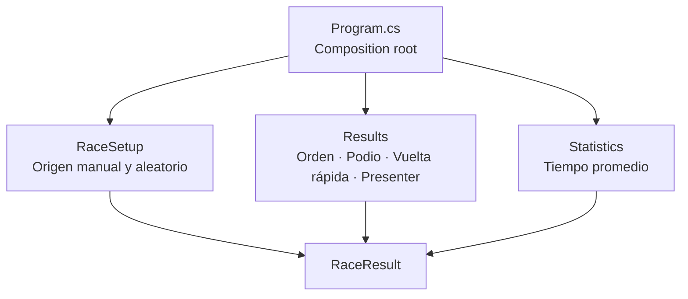

[English](README.md) · **Español**

# 🏁 Race Results


**Aplicación de consola en C# que ordena, rankea y presenta los resultados de una carrera de autos.**

---

## Sobre el proyecto

Race Results toma una lista de resultados de carrera y arma el podio, la tabla completa, la vuelta más rápida y el tiempo promedio. Las carreras se pueden generar al azar o cargar a mano, y se pueden correr varias seguidas sin reiniciar.

Lo hice para el primer parcial de *Estructura de Datos* de la tecnicatura en videojuegos. Además de cumplir la consigna, lo organicé por features, validé cada entrada y lo cubrí con tests automatizados.

## Características

- Ordenamiento por posición final con un **Insertion Sort** explícito sobre una copia, así la entrada nunca se modifica.
- Podio con los tres primeros, reutilizando el mismo ordenamiento.
- Vuelta más rápida mediante **búsqueda lineal**, con desempate determinista: primero la mejor posición final y después el número de auto menor.
- Tiempo promedio de carrera.
- Dos formas de crear una carrera: generación aleatoria o ingreso manual.
- Tiempos en formato `mm:ss`.
- Varias carreras por sesión, cada una con estado nuevo.

## Ejemplo de salida

```text
========================================
                 PODIUM
========================================
1st | #27 | Emiliano | 05:16
2nd | #11 | Sofia | 05:20
3rd | #44 | Mateo | 05:27

========================================
              FASTEST LAP
========================================
The fastest car is 11 with a time of 01:08

========================================
               STATISTICS
========================================
Average race time: 05:21
```

## Highlights técnicos

- **Organizado por features:** `RaceSetup`, `Results` y `Statistics` viven en sus propias carpetas alrededor de un único modelo `RaceResult`; `Program.cs` es el composition root.
- **Strategy solo donde suma:** `IRaceResultSource` tiene dos implementaciones reales, `ManualRaceResultSource` y `RandomRaceResultSource`. No se agregaron interfaces para clases con una sola implementación.
- **Carreras aleatorias que prueban que el ordenamiento funciona:** las carreras generadas vuelven desordenadas, y la vuelta más rápida puede ser de alguien distinto al ganador.
- **Validación de entradas que nunca corta la ejecución:** de 3 a 20 corredores, números de auto del 1 al 999, sin duplicados, tiempos positivos y finitos, y una vuelta más rápida que no supere el tiempo total. Ante un dato inválido vuelve a pedirlo en lugar de salir.
- **30 tests con xUnit** que cubren ordenamiento, desempates, podio, validaciones, formato de tiempos, tokens de las plantillas, ingreso aleatorio y manual, y casos borde como `NaN`, infinito y fin de entrada inesperado.

## Arquitectura



| Algoritmo         | Dónde             | Complejidad                                     |
| ----------------- | ----------------- | ----------------------------------------------- |
| Insertion Sort    | `SortResults()`   | O(n) en el mejor caso, O(n²) promedio y peor caso; O(n) de memoria extra por la copia |
| Búsqueda lineal   | `GetFastestCar()` | O(n)                                            |
| Podio             | `GetPodium()`     | Reutiliza `SortResults()` y toma los tres primeros |

Para un scoreboard de 3 a 20 corredores, estos algoritmos simples son la elección adecuada, y escribirlos explícitamente en lugar de usar `OrderBy()` mantiene visible el objetivo académico.

<details>
<summary><b>Requisitos académicos cubiertos</b></summary>

| Requisito | Implementación |
| --- | --- |
| Clase `RaceResult` | `Domain/RaceResult.cs` |
| `SortResults()` | Insertion Sort explícito |
| `GetFastestCar()` | Búsqueda lineal |
| `GetPodium()` | Reutiliza `SortResults()` |
| Lista o arreglo como entrada | `IList<RaceResult>` |
| Plantillas de salida | `RaceResultTemplates` |
| Reemplazo de tokens | `RaceResultsConsolePresenter` |
| Formato minutos y segundos | `TimeFormatter` |

</details>

<details>
<summary><b>Estructura del proyecto</b></summary>

```text
RaceResults/
├── RaceResults.slnx
├── RaceResults/
│   ├── Program.cs
│   ├── Domain/
│   │   └── RaceResult.cs
│   └── Features/
│       ├── RaceSetup/      Orígenes de datos, configuración por consola y reglas
│       ├── Results/        Ordenamiento, vuelta rápida, plantillas, presenter, formato de tiempo
│       └── Statistics/     Tiempo promedio de carrera
└── tests/
    └── RaceResults.Tests/  Tests xUnit organizados por feature
```

</details>

## Cómo ejecutar el proyecto

### Requisitos

- **.NET 10 SDK**

### Ejecutar

```bash
git clone https://github.com/EmilianoBazanZapata/RaceResult.git
cd RaceResult/RaceResults
dotnet run --project RaceResults/RaceResults.csproj
```

### Tests

```bash
dotnet test RaceResults.slnx -c Release
```

## Alcance actual

La aplicación trabaja completamente en memoria y usa la consola como única interfaz. Posibles próximos pasos: guardar los resultados en un archivo y sumar una interfaz gráfica.

## Licencia

MIT. Ver [`LICENSE`](LICENSE).

---

**Binary Suns Studio** · [Web](https://binarysunsstudio.com.ar) · [itch.io](https://emiliano-bazan-zapata.itch.io) · [LinkedIn](https://www.linkedin.com/in/emiliano-bazán-zapata-18705721a)
