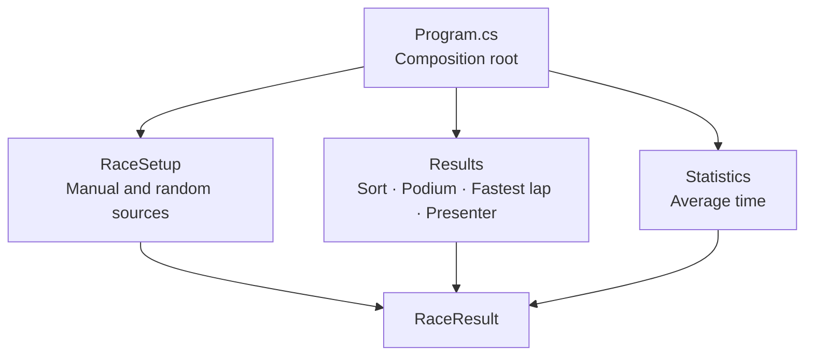

**English** · [Español](README.es.md)

# 🏁 Race Results


**A C# console app that sorts, ranks and presents the results of a car race.**

---

## About the project

Race Results takes a list of race results and builds the podium, the full results table, the fastest lap and the average race time. Races can be generated randomly or entered by hand, and several races can run in a row without restarting.

It was built for the first exam of *Data Structures* in my video game development degree. Beyond the academic requirements, I organized it by feature, validated every input and covered it with automated tests.

## Features

- Sorting by final position with an explicit **Insertion Sort** on a copy, so the input is never modified.
- Podium of the top three, reusing the same sort.
- Fastest lap through a **linear search**, with a deterministic tie-break: better final position first, then the lower car number.
- Average race time.
- Two ways to create a race: random generation or manual entry.
- Times shown as `mm:ss`.
- Several races per session, each with fresh state.

## Example output

```text
========================================
                 PODIUM
========================================
1st | #27 | Emiliano | 05:16
2nd | #11 | Sofia | 05:20
3rd | #44 | Mateo | 05:27

========================================
              FASTEST LAP
========================================
The fastest car is 11 with a time of 01:08

========================================
               STATISTICS
========================================
Average race time: 05:21
```

## Technical highlights

- **Organized by feature:** `RaceSetup`, `Results` and `Statistics` live in their own folders around a single `RaceResult` model; `Program.cs` is the composition root.
- **Strategy only where it pays off:** `IRaceResultSource` has two real implementations, `ManualRaceResultSource` and `RandomRaceResultSource`. No interface was added for classes with a single implementation.
- **Random races that prove the sort works:** generated races come back shuffled, and the fastest lap can belong to someone other than the winner.
- **Input validation that never crashes:** 3 to 20 racers, car numbers 1 to 999, no duplicates, positive finite times and a fastest lap no greater than the total time. Invalid input asks again instead of exiting.
- **30 xUnit tests** covering sorting, tie-breaks, podium, validation, time formatting, template tokens, random and manual input, and edge cases such as `NaN`, infinity and unexpected end of input.

## Architecture



| Algorithm         | Where           | Complexity                                   |
| ----------------- | --------------- | -------------------------------------------- |
| Insertion Sort    | `SortResults()` | O(n) best, O(n²) average and worst; O(n) extra memory for the copy |
| Linear search     | `GetFastestCar()` | O(n)                                       |
| Podium            | `GetPodium()`   | Reuses `SortResults()` and takes the top three |

For a scoreboard of 3 to 20 racers, these simple algorithms are the right fit, and writing them explicitly instead of using `OrderBy()` keeps the academic goal visible.

<details>
<summary><b>Academic requirements covered</b></summary>

| Requirement | Implementation |
| --- | --- |
| `RaceResult` class | `Domain/RaceResult.cs` |
| `SortResults()` | Explicit Insertion Sort |
| `GetFastestCar()` | Linear search |
| `GetPodium()` | Reuses `SortResults()` |
| List or array as input | `IList<RaceResult>` |
| Output templates | `RaceResultTemplates` |
| Token replacement | `RaceResultsConsolePresenter` |
| Minutes and seconds format | `TimeFormatter` |

</details>

<details>
<summary><b>Project structure</b></summary>

```text
RaceResults/
├── RaceResults.slnx
├── RaceResults/
│   ├── Program.cs
│   ├── Domain/
│   │   └── RaceResult.cs
│   └── Features/
│       ├── RaceSetup/      Sources, console setup and shared rules
│       ├── Results/        Sorting, fastest lap, templates, presenter, time format
│       └── Statistics/     Average race time
└── tests/
    └── RaceResults.Tests/  xUnit tests organized by feature
```

</details>

## Getting started

### Requirements

- **.NET 10 SDK**

### Run

```bash
git clone https://github.com/EmilianoBazanZapata/RaceResult.git
cd RaceResult/RaceResults
dotnet run --project RaceResults/RaceResults.csproj
```

### Test

```bash
dotnet test RaceResults.slnx -c Release
```

## Current scope

The app runs fully in memory, with the console as its only interface. Possible next steps are saving results to a file and a graphical front end.

## License

MIT. See [`LICENSE`](LICENSE).

---

**Binary Suns Studio** · [Website](https://binarysunsstudio.com.ar) · [itch.io](https://emiliano-bazan-zapata.itch.io) · [LinkedIn](https://www.linkedin.com/in/emiliano-bazán-zapata-18705721a)
